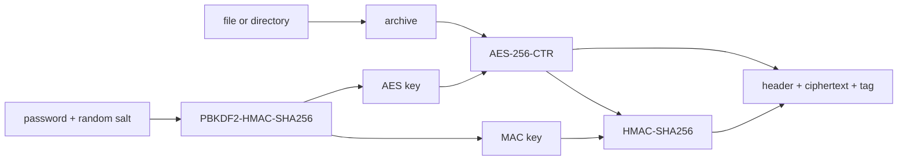

<div align="center">

# pamble

**Password-encrypt a file or a whole directory into one authenticated file. Every primitive written from scratch in C17.**

[](https://github.com/pandalinoox/pamble/actions/workflows/ci.yml)
[](https://github.com/pandalinoox/pamble/releases/latest)
[](LICENSE.md)


</div>

---

```text
$ pamble encrypt photos
password:
confirm password:
[1/5] archiving files...
[2/5] deriving keys: 1,200,000/1,200,000 iterations
[3/5] [====================] 100% encrypting
[4/5] [====================] 100% authenticating
[5/5] writing output...
pamble: wrote photos.pamble
```

## Why

pamble is a learning project that goes all the way down. There is no OpenSSL, no libsodium, no tar: the archive format, SHA-256, HMAC, PBKDF2, AES-256 and CTR mode are all implemented here, tested against published vectors, and documented module by module.

## Features

- **One file in, one file out.** Files and whole directory trees, with permission bits kept.
- **Authenticated encryption.** AES-256-CTR, then HMAC-SHA256 over the header and ciphertext (encrypt-then-MAC). A wrong password or a single flipped bit is caught before anything is decrypted.
- **Slow on purpose where it counts.** Keys come from PBKDF2-HMAC-SHA256 with 600,000 iterations and a random salt per file.
- **Safe on disk.** Output is written to a temporary file and renamed into place. Extraction refuses absolute paths, `..`, and overwriting existing files.
- **Clean failure.** Keys, intermediate state and plaintext are wiped with `explicit_bzero` on every exit path.
- **Live progress.** Each stage is reported as it runs; on a terminal the line redraws in place, and piped output stays plain.

## Install

### Prebuilt binary

Each [release](https://github.com/pandalinoox/pamble/releases) ships a statically linked binary for x86-64 Linux, with a SHA-256 checksum.

```sh
VERSION=v1.0.0
curl -LO "https://github.com/pandalinoox/pamble/releases/download/$VERSION/pamble-$VERSION-linux-x86_64.tar.gz"
curl -LO "https://github.com/pandalinoox/pamble/releases/download/$VERSION/pamble-$VERSION-linux-x86_64.tar.gz.sha256"
sha256sum -c "pamble-$VERSION-linux-x86_64.tar.gz.sha256"
tar -xzf "pamble-$VERSION-linux-x86_64.tar.gz"
sudo install -m 755 "pamble-$VERSION-linux-x86_64/pamble" /usr/local/bin/pamble
pamble --version
```

To install without `sudo`, copy the binary into `~/.local/bin` instead and make sure that directory is on your `PATH`.

### From source

Needs a C17 compiler and CMake 3.31 or newer.

```sh
git clone https://github.com/pandalinoox/pamble.git
cd pamble
cmake -S . -B build -DCMAKE_BUILD_TYPE=Release -DPAMBLE_BUILD_TESTS=OFF
cmake --build build
sudo cmake --install build        # installs to /usr/local/bin
```

| CMake option | Default | Effect |
| --- | --- | --- |
| `PAMBLE_BUILD_TESTS` | `ON` | Build the test suite; needs [Criterion](https://github.com/Snaipe/Criterion) (`libcriterion-dev`) |
| `PAMBLE_STATIC` | `OFF` | Link the binary statically, as release builds do |

Use `--prefix ~/.local` with `cmake --install` to install for your user only.

## Quick start

```sh
pamble encrypt photos              # writes photos.pamble
pamble decrypt photos.pamble out   # recreates out/photos
```

## Usage

```text
pamble encrypt <file-or-directory> [output-file]
pamble decrypt <encrypted-file> [output-directory]
pamble --version
pamble --help
```

| | Default when the output is left out |
| --- | --- |
| `encrypt` | `<input>.pamble`, next to the input. `photos/` gives `photos.pamble`. |
| `decrypt` | The directory holding the encrypted file. The archive carries its own top folder, so `photos.pamble` gives back `photos/` beside it. |

- **Password:** typed without echo, twice when encrypting. When stdin is not a terminal, its first line is used, so `printf '%s\n' "$PW" | pamble decrypt ...` works in scripts.
- **Output directory:** a missing one is created, parents included. If decryption fails, a directory created by that run is removed again.
- **Overwriting:** extraction never overwrites existing files. Decrypting next to the original folder fails until it is moved away.
- **Exit status:** `0` on success, `1` on failure, `2` for usage errors. Progress and messages go to stderr.

## How it works



Decryption runs the same steps backwards and checks the tag before it decrypts a single byte. The full pipeline is in [docs/pamble_crypto.md](docs/pamble_crypto.md).

### File format

| Field | Bytes | Contents |
| --- | ---: | --- |
| magic | 6 | `PMBENC` |
| version | 1 | `1` |
| salt | 12 | Random per file |
| nonce | 12 | Random per file |
| archive length | 8 | Big-endian |
| ciphertext | n | AES-256-CTR of the archive |
| tag | 32 | HMAC-SHA256 over everything above |

## Roadmap

- [ ] **Multithreaded AES-CTR.** Every keystream block depends only on its counter, so the buffer splits into one block range per thread with no locks and no format change. Worker threads add to an atomic byte count; only the main thread reports progress.
- [ ] **Faster AES rounds.** Replace the bit-by-bit GF(2^8) multiply in MixColumns with precomputed tables. This is the largest single-thread win.
- [ ] **Half the key-derivation time.** Derive 32 bytes with PBKDF2 and split them with HKDF-Expand instead of deriving 64. Changes the key schedule, so it ships as format version 2, with version 1 still readable.
- [ ] **Streaming and per-chunk tags.** Chunked encrypt-then-MAC, so large inputs no longer have to fit in memory and HMAC can run in parallel too.
- [ ] **Constant-time AES.** A bitsliced S-box or AES-NI, removing the cache-timing exposure of table lookups.

## Security

pamble has not been audited. It is built to learn how these pieces fit together, and it is tested against FIPS-197, NIST SP 800-38A and RFC 4231 vectors. Known limits:

- The AES S-box is a lookup table, which can leak key bits through cache timing on shared hardware.
- The whole archive is held in memory during encryption and decryption.
- A wrong password and a modified file give the same error on purpose.

For anything that matters, use a reviewed tool such as [age](https://github.com/FiloSottile/age).

## Project layout

```text
include/pamble/   public headers, one per module
src/              implementations and main.c
tests/            Criterion test suites
docs/             one design document per module
```

| Module | Documentation |
| --- | --- |
| Encrypt and decrypt pipeline | [pamble_crypto.md](docs/pamble_crypto.md) |
| Progress reporting | [pamble_progress.md](docs/pamble_progress.md) |
| Archive format | [pamble_archive.md](docs/pamble_archive.md) |
| AES-256 | [pamble_aes.md](docs/pamble_aes.md) |
| AES-256-CTR | [pamble_aes_ctr.md](docs/pamble_aes_ctr.md) |
| PBKDF2 | [pamble_pbkdf2.md](docs/pamble_pbkdf2.md) |
| HMAC-SHA256 | [pamble_hmac_sha256.md](docs/pamble_hmac_sha256.md) |
| SHA-256 | [pamble_sha256.md](docs/pamble_sha256.md) |
| Status codes | [pamble_status.md](docs/pamble_status.md) |

## Contributing

Contributions are welcome, especially on the roadmap above. Start with [CONTRIBUTING.md](CONTRIBUTING.md). Maintainers cutting a release should follow [docs/releasing.md](docs/releasing.md).

## License

Released under the [MIT License](LICENSE.md).
